# TODO — the hosted surveillance system

What exists today is the middle of a larger system: a script that turns one PFI report into one
auditable verdict. This file records the whole shape so the parts still missing are visible, and
tracks what is left to do.

*Figure 1 — the proposed system. Solid blue is built and running; dashed amber is not built yet.
Source: [`docs/img/surveillance_system.mmd`](docs/img/surveillance_system.mmd).*

## The motivation, restated

An analyst needs two things that pull in opposite directions, and the system's job is to give both
without compromising either:

1. **Breadth.** Across every site and every swab collected so far: what is being tracked, where,
   how often, and is anything trending. That is the managing dashboard.
2. **Depth, on demand.** For any single organism in any single swab: *why* was it ranked where it
   was ranked — which rule fired, on what measurement, and what the rule could not see. That is
   the per-swab report, and it must be legible without reading the source.

Neither is served by a wall of text. The per-swab report already carries ~50,000 words of
evidence; the answer is ranking and layering, never deletion, because the deleted row is the one
someone asks about six months later.

## The four stages

**1 · Intake.** A run is triggered — by an analyst or a scheduler — with one PFI HTML report plus
its metadata: site, collection date, sequencing flowcell/run ID. The metadata is *hand-supplied*
and never inferred. Today it lives in `analysis/sample_metadata.tsv`; in the hosted system it is a
form field or an LIMS pull.

**2 · Triage.** `analysis/triage.py` runs the 12-gate cascade and emits two artefacts per swab:

| Artefact | Audience | Status |
|---|---|---|
| `<id>_report.html` | the analyst | built |
| `<id>_report.json` | the database | built |

Both come from the same in-memory evidence, so the report and the record cannot disagree. The
JSON is what lets the HTML be condensed — nothing is lost by putting detail behind a tab, because
the full structure is in the record regardless.

**3 · The database.** `analysis/sample_registry.json` today; a real store later. It holds per-swab
loads, verdicts, cohort membership, and the BEC criteria that fired. It is **load-bearing, not a
cache**: gate 8 measures cross-sample enrichment against it, and the same swab reaches a different
verdict against a different cohort (WBM156 is MONITOR against four siblings, NO ACTION against
none). Each report records a cohort fingerprint so a stale one is spotted.

**4 · The managing dashboard.** Not built. It reads the database only — never a PFI report — and
carries what is programme-level rather than swab-level:

- swabs analysed, and the verdict breakdown across all of them
- sites and swab locations
- longitudinal view: site × time
- pathogen history: which organism appeared in which swab, when
- drill-down into any individual report

## Open work

### Dashboard
- [ ] Dashboard builder script: read the registry + `_report.json` files, emit the dashboard.
- [ ] The four panels above. Designs sketched in `docs/dashboard_design.md`.
- [ ] Decide the store. JSON is fine at 5 swabs and wrong at 500; SQLite is the obvious next rung.

### Data that is missing, and blocks analysis
- [ ] **`collected_at` and `run_id` are blank** in `analysis/sample_metadata.tsv`. Without
      `collected_at` there is no longitudinal axis at all. Without `run_id` a cross-site fold
      change confounds site with sequencing batch, and the batch-robust check cannot run. Both get
      harder to recover with time — this is the most urgent item in the file.
- [ ] **`vf_core` covers 1 of 25 watchlist organisms** (only *A. baumannii*). Every other organism
      reports "no core-determinant set is curated", which is honest but not useful. Needs a
      literature pass per organism.

### Engine and report
- [ ] BEC v1 strengths are ordinal judgements, not calibrated. If ground truth ever exists
      (culture + AST on the same swabs), calibrate them and say so — until then the report must
      keep stating they are not likelihood ratios.
- [ ] Orphan-marker sweep: decide whether a marker with no host organism is worth reporting.
- [ ] A synthetic `ESCALATE` sample, so the top of the ladder is exercised by a test.
- [ ] Filters in both dashboard mockups are inert.
- [ ] `--html WBM232` resolves to the `WBM232/` PFI directory and picks `Classify.DNA.html`, which
      has no `globalData`. `WBM232_en.html` works. Fix the resolution order.
- [ ] `dashboard_design.html` uses 8 distinct border-radius values and `system-ui` as its primary
      face.
- [ ] README: a troubleshooting entry for `docker.sock` permissions.
- [ ] WDL: rename the `evidence` output slot.

### Repo hygiene
- [ ] `git branch -D backup-pre-scrub` — local-only, sits at the pre-rewrite commit, and its git
      objects still contain donor IDs. `github.com/alvin8-git/HTX` is public.
- [ ] 4 commits on `main` are unpushed.
