# Independent review — method and report design

Reviewer brief: clinical microbiology, biosurveillance systems, information design. Two phases.
**Phase 1 (blind)** used only the PFI outputs (`WBM*/` xlsx tables, `WBM*_en.html`,
`sampleInfo.xlsx`), `Zymo/`, and the MGI ZTRON manual; it ended **2026-10-26 05:50 UTC**
(`/data/alvin/tmp/phase1_end.txt`). **Phase 2** then read `README.md`,
`docs/automated_triage_design.md`, `docs/reference_triage.md`,
`docs/active_species_and_gene_logic.md`, `analysis/triage.py`, `analysis/triage_rules.json`,
`analysis/sample_registry.py`, `analysis/triage_report.py` and the generated
`analysis/triage_report.html`, and ran the engine.

Assumptions, stated once. (a) The five swabs are a one-off pilot, and the target is a repeating
programme over the same sites — this is what makes the longitudinal section the centre of the
review. (b) The reader of the output is an operations officer who is not a microbiologist, with a
microbiologist available on escalation. (c) `sampleInfo.xlsx` site strings are accurate.
(d) I did not re-derive taxonomy, CDC/WHO list membership, or MEGARes/VFDB content; where I name
such a list I say whether I verified it. Everything marked **[unverified]** is a claim I could not
check from the repository or the data.

---

## 1. Verdict in five sentences

Keep the engine and keep the gate cascade: it is a sound, auditable design, its tiers are honestly
defined, and my blind triage reached the same operational answer as the engine on all five swabs.
Do not keep the output as it stands — the evidence report is **64,496 visible words across five
swabs** (measured on `analysis/triage_report.html`), which is not a decision artefact but a
database rendered as prose. The one change with the highest value is to make **site identity, not
sample identity, the primary key**: `analysis/sample_metadata.tsv` already defines `site_id`, but
gate 8 compares a swab against *other sites* (`triage.py:280-286`), which is the wrong comparator
for a fixed-site programme and is confounded by batch, as `docs/reference_triage.md:250-287`
already concedes. Second-highest value: the rule file is the right idea in nearly the wrong format
— a flat decision table of one row per rule would be equally auditable and far easier for a
microbiologist to argue with. Everything else in this review is secondary to those two.

---

## 2. Phase 1 — independent design

### 2.1 What PFI actually provides, and what it is worth

Field inventory taken from `WBM232/*.xlsx` and the `globalData` object parsed out of
`WBM232_en.html` (keys: `basicSummary`, `commonData`, `indentification_DNA`,
`indentification_RNA`, `speciesActivity`, `virulence`, `drugResistance`).

| Field | Source | Grade | Why |
|---|---|---|---|
| `Raw_Read`, `Clean_Read`, `Host_Read`, `Classified_Read` | `Basic.stat.xlsx` | **decision-grade** | Sets the floor on what the run could have seen. WBM156 lost 91.28% to host, leaving 622,642 classified reads vs WBM232's 2,590,665. |
| `Raw_Q20`, `Raw_Q30`, `Raw_GC` | `Basic.stat.xlsx` | context | Q30 is 98.02–98.49% in all five: never discriminating here. |
| `Unclassified_Rate` | `Classify.stat.xlsx` | **decision-grade** | 73.83–90.52%. A surface-swab run is mostly unidentifiable; any claim of completeness is false. |
| `Scientific Name`, `Taxid` | `Classify.DNA.Species.xlsx` | **decision-grade** | Taxid is the only stable key. |
| `Real Read` | same | **decision-grade** | Species-specific reads. The honest count. |
| `Estimate Read`, `Abundance` | same | context, trap | Bracken redistribution. WBM232 *K. pneumoniae*: 311 real → 23,703 estimate (76×). |
| `Type` (Bacteria/Fungi/Viruses/…) | same | context | Internally inconsistent: *Babesia bigemina* is `Metazoa_Parasite` in WBM174/179/185 and `Fungi` in WBM232; *Prototheca ciferrii* is `Fungi` in WBM156 and `Metazoa_Parasite` in WBM179. |
| `Human Infection` | same | **noise** | Y on 80/373 (WBM156) to 128/929 (WBM174) rows, and *Escherichia coli* is flagged `N` in every Zymo run while *Salmonella enterica* is `Y`. Not usable as a pathogenicity signal. |
| `Chinese Name` | same | noise | Localisation. |
| Subspecies table | `Classify.DNA.SubSpecies.xlsx` | context, trap | 81–178 rows. Entries like `Klebsiella pneumoniae subsp. pneumoniae` at **20 real / 39,859 estimate / 1.68%** (WBM232) are Bracken artefacts at subspecies rank. |
| `Group`, `Gene`, `Class`, `Mechanism`, `Type` | `Resistance.DNA.xlsx` | **decision-grade** after filtering | 33–90 rows/sample. `Group` is the real unit; `Gene` (`MEG_xxxx`) is one allele. |
| AMR `Coverage(%)`, `Depth` | same | **decision-grade** | The only quality axis. Minimum coverage is ~50% in every sample, i.e. the table is pre-truncated at 50%. |
| `Virulence Factor`, `Pathogen`, `VF Protein`, `Coverage(%)`, `Depth` | `Virulence.DNA.xlsx` | mostly **noise** | 252–657 rows. Rows passing both 80% coverage and 5× depth: **1, 4, 8, 5, 2** across the five samples. The rest is cross-mapping. |
| `speciesActivity` | `globalData` | **absent by construction** | Empty in all five; needs an RNA library. |
| `showRNA` | `globalData` | **decision-grade** | `False` everywhere. This is the single most important field for honesty of reporting. |
| `version` | `globalData` | context | `software:V5.1.2 database:version: 5.1.1`, identical in all ten reports including Zymo. |
| Per-species extracted FASTQ | `ExtractRead_DNA/Species/` | context | 373–967 directories per sample; outside the HTML contract. |

**Useful fields that do not exist.** No AMR-to-organism join (MEGARes has no organism column, and
nothing in `globalData` links `drugResistance` rows to `speciesData`). No RNA library, so no RNA
viruses and no activity — absence here is untested, not negative. No run date, flowcell or library
ID anywhere in the report, so batch cannot be distinguished from site. No negative extraction
control in the batch. No per-taxon read depth or genome coverage: `Real Read` is a count, not
breadth over a genome, so a trace organism's identification cannot be quality-scored the way an
AMR gene can. No unique/duplicate read fraction. No confidence or score per taxonomic assignment.

### 2.2 The minimal rule set

Seven rules. Each is one line: field, threshold, output. R0 is a precondition, not a finding.

| # | Rule | Input field | Threshold | Output |
|---|---|---|---|---|
| R0 | QC floor | `Classified_Read` | < 1,000,000 | mark the site **QC-limited**; a negative result carries no weight |
| R1 | Read floor | `Real Read` | < 100 | drop the row entirely |
| R2 | Inflation guard | `Estimate Read` / `Real Read` | > 10 | judge the row on `Real Read` only, never on `Abundance` |
| R3 | Site enrichment | `Real Read` ÷ `Classified_Read` × 10⁶, vs this site's own history (or, with no history, vs the median of the other sites) | ≥ 5× | candidate finding |
| R4 | Named-organism check | species name vs a fixed, versioned watchlist | on list | candidate finding regardless of R3 |
| R5 | Acquired resistance | AMR `Group` on a fixed acquired-gene list, `Coverage(%)` and `Depth` | ≥ 80% and ≥ 5× | report the gene for the **site**, never attributed to an organism |
| R6 | Untestable agents | `showRNA` | `False` | emit one standing line: RNA agents **not tested** |

A candidate from R3 or R4 that also has an R5 gene of a class relevant to it is the only
combination that earns a human's time. R1 at 100 rather than 50: in the Zymo runs the
non-member rows with ≥ 100 real reads number 8–15 out of 34–70, so 100 is where a certified-clean
sample still generates a handful of false rows rather than dozens. R5's 80%/5× is the Zymo-derived
pairing I would adopt as a starting point **[unverified against an independent AMR truth set]**.

### 2.3 The conclusion scale for a *site*

Three levels plus two orthogonal flags.

| Level | Meaning | Who acts |
|---|---|---|
| **BASELINE** | Nothing above the site's own history, or nothing above the threshold | nobody; log it |
| **NOTE** | A watchlist organism or an acquired gene is present, but at background for this site | microbiologist reads it at the next weekly review |
| **CONFIRM** | A watchlist organism is enriched at this site *and* carries co-located acquired resistance of a relevant class | culture with AST, and resample the site |
| flag: **NOT TESTED** | RNA agents, always, on this assay | nobody; it is a standing caveat, not an event |
| flag: **QC-LIMITED** | R0 fired | re-swab before reading any negative |

Three, not four, because an operations officer has exactly three possible responses to a surface
swab: file it, have someone look at it, or send a team. A fourth level forces a distinction with
no distinct action behind it. **NOT TESTED** must be a flag rather than a level: it is true of
every run of this assay, so it is a property of the method, not a verdict about a site, and making
it a level invites the reading "this site is NOT TESTED" when what is untested is a class of
agents everywhere. **QC-LIMITED** is the flag the current design lacks and most needs: WBM156 has
a fifth of WBM232's classified reads, and its shorter hit list is sensitivity, not cleanliness.

### 2.4 The report I would hand an operations officer

One page per site. Top to bottom:

1. **Header** — site label, collection date, run id, and a QC gauge (clean reads against the
   1M floor, host %). One standing line: "DNA assay: RNA viruses not tested."
2. **Verdict strip** — BASELINE / NOTE / CONFIRM, one sentence of reason, flags.
3. **Flagged organism cards, at most three** — organism, reads, abundance, how it compares to this
   site's own history, and a three-box checklist (enriched / acquired gene co-located / marker),
   then the action.
4. **Three graphical panels** (§4.2).
5. **Collapsed evidence appendix** — everything else.

Omitted from page one: the full species table, the full AMR table, every VFDB row, the
per-agent NOT_TESTED enumeration, `Human Infection`, `Chinese Name`, subspecies rows, and
`Estimate Read` wherever R2 fired.

### 2.5 Longitudinal layer

*Figure 1 — longitudinal comparison for five fixed sites. Source: [`img/review_longitudinal.mmd`](img/review_longitudinal.mmd).*

A site is the unit. Each new report is normalised to reads per million classified (the same
normalisation the engine already uses) and compared **first against that site's own history**: a
robust z-score against the site's median and MAD, flagging at z ≥ 3 with at least 100 reads. Only
when a site has fewer than three prior runs does it fall back to the cross-site comparison, which
is the current engine's only mode. The site's own history is immune to the between-site
differences — a restroom tap is not a trolley handle — and partly immune to batch, because over
many runs batch becomes noise rather than a confound.

Minimum stored state, one row per site × date × taxon: `site_id`, `collected_at`, `run_id`,
`taxid`, `real_reads`, `classified_reads`; plus one row per site × date × AMR `Group` with
coverage and depth. No sequences, no report content. That is a few KB per run.

---

## 3. Phase 2 — reconciliation with the engine

### 3.1 How the engine reaches a verdict

*Figure 2 — the gate cascade as traced in `analysis/triage.py`. Source: [`img/review_gates.mmd`](img/review_gates.mmd).*

| Gate | Input | Threshold | Effect on tier | Code |
|---|---|---|---|---|
| 12 integrity | `Clean/Unclassified/Classified_Read` | partition must sum | problem list, not a tier | `triage.py:172-202` |
| list lookup | `Taxid` | threat_list / clinical_watchlist | routes the row | `triage.py:662-685` |
| 2 detectability | `genome == RNA`, `showRNA` | — | → `NOT_TESTED`, before the read floor | `triage.py:811-814` |
| 1 read floor | `Real Read` | `min_real_reads` = 50 | listed → `NO_ACTION`; unlisted → dropped | `triage.py:714-729, 784-785, 816-823` |
| 7 inflation | `Estimate/Real` | `bracken_inflation_ratio` = 10 | note only, no tier change | `triage.py:705-707` |
| 6 amplification | unique-read fraction | 0.15, `--with-fastq` only | → `NO_ACTION`; inert by default | `triage.py:215-237` |
| 8 enrichment | reads per million classified ÷ **max** of other samples | `enrichment_fold` = 5.0 | below → unlisted row dropped; drives watchlist escalation | `triage.py:280-286, 743-751, 788-792` |
| 9 near neighbour | congener `Real Read` | ≥ this taxon's reads | `CONFIRM` → `NO_ACTION` | `triage.py:827-836` |
| 10a marker | VFDB rows vs `marker_patterns`; Poisson power | present → up; absent with power ≥ 0.90 → down; absent below → `NOT_TESTED` | → `ESCALATE` / `NO_ACTION` / `NOT_TESTED` | `triage.py:838-866` |
| subspecies cap | `subspecies_required` | — | `CONFIRM` → `MONITOR` | `triage.py:868-873` |
| 10b supporting | VFDB rows | one-way | present → `ESCALATE` | `triage.py:875-889` |
| watchlist | enrichment + gene class + host share 0.20 | all four conditions | → `CONFIRM`, else `MONITOR` | `triage.py:752-779`, `518-553` |
| 3 allele collapse | MEGARes `Group` | max(breadth, depth) | one call per group | `triage.py:462-466` |
| 4 breadth floor | `Coverage(%)` | `gene_breadth_floor` = 50 | → `NO_ACTION` | `triage.py:471-472` |
| 5 class | `Group`, `Mechanism` | annotation map | rRNA/intrinsic/efflux/point → `NO_ACTION` | `triage.py:473-488`, `398-421` |
| gene call | breadth, depth | 80%/5× full, or 55%/10× partial | `CONFIRM`, else `MONITOR` | `triage.py:489-504`, rules `class_thresholds` |
| roll-up | row tiers | see `docs/reference_triage.md:126-131` | sample verdict | `triage.py:941-989` |

### 3.2 Phase 1 verdicts against the engine, sample by sample

My blind calls, applying §2.2–2.3 by hand, next to `analysis/triage_<sample>.tsv` from
`python3 analysis/triage.py` (run 2026-10-26, `rules=f76746d8b7fc`).

| Sample | My call | Engine sample verdict | Agree? |
|---|---|---|---|
| WBM156 ferry restroom tap | **NOTE**, QC-LIMITED | `MONITOR` | yes, modulo the missing QC flag |
| WBM174 T3 passport scanner | **BASELINE** | `NO ACTION` | yes |
| WBM179 T3 fingerprint reader | **BASELINE** | `NO ACTION` | yes |
| WBM185 T3 check-in kiosk | **NOTE** | `INVESTIGATE` | one step apart |
| WBM232 T4 trolley handles | **CONFIRM** | `INVESTIGATE` | yes |

Row-level disagreements, every one of them:

| Sample | Organism / gene | My call | Engine call | Right? | Why |
|---|---|---|---|---|---|
| WBM156 | *Providencia rettgeri*, 193 rd, only sample | NOTE at most | `MONITOR`, and the **sole driver** of the sample verdict | **mine** | 193 reads, present in one batch and absent from four, at 7.29% clean-read yield. `docs/reference_triage.md:275` reaches the same conclusion and calls the enrichment unsupported, but the engine still ships it as the verdict driver. |
| WBM156 | whole sample | QC-LIMITED | no QC flag exists | **mine** | 622,642 classified reads, 91.28% host. Nothing in the tier system records that this swab could not have seen much. |
| WBM156 | *Neisseria subflava* 11,326 rd, *Prevotella melaninogenica* 10,773 rd | oral flora, suppress | `MONITOR`, 37× and 30× enriched | **engine, technically; mine, operationally** | The enrichment is real. But 56 community-context `MONITOR` rows in one sample is a reporting failure, not 56 findings. |
| WBM179 | *Corynebacterium diphtheriae*, 1,553 rd, 8× the median of other samples | NOTE — read it | absent from the flagged layer; `C. diphtheriae` is on neither list | **mine** | Toxigenicity needs *tox*, which is a marker question the engine already knows how to ask. A named human pathogen at 1,553 species-specific reads should not fall through silently, even as "non-toxigenic until shown otherwise". |
| WBM179 | *Corynebacterium segmentosum* 353,463 rd (13.87%), *Dolosigranulum pigrum* 98,464 rd | the real story of this swab: a dominant single-organism community | `MONITOR`, community-context, `tier='-'` | **engine on the tier, mine on prominence** | 52× and 32× enriched. For a fingerprint reader this is the most informative observation in the sample and it is buried. |
| WBM185 | *mecA* 90.9%/10.5×, CTX-M 82.9%/7.25×, *mupA* 90.2%/11.7× | NOTE: real genes, host unknown, skin flora is the likely owner | `INVESTIGATE` on the genes alone | **arguable; I lean mine** | The engine's own roll-up (`triage.py:944-958`) escalates on a high-consequence gene with no organism attached. `S. hominis` at 164,436 reads is the obvious carrier and is not on any list. Calling a site INVESTIGATE because normal skin flora carries *mecA* will, repeated weekly, train the reader to ignore the word. |
| WBM232 | *A. baumannii* 6,496 rd, 4.72%, with CTX-M and ANT3 co-located | **CONFIRM** | `CONFIRM` (row), `INVESTIGATE` (sample) | **agree** | The one genuine operational finding in the batch. |
| WBM232 | *Nigrospora oryzae* 32,208 rd, *Acaromyces ingoldii* 9,845 rd | environmental fungi, note only | `MONITOR`, 178× and 852× enriched | **agree on tier** | Plant fungi on an outdoor-adjacent trolley. Correct and uninteresting; it illustrates that enrichment ≠ relevance. |
| all five | *S. aureus* (106–3,654 rd) | present, unremarkable | `NOT_TESTED` (seb not assessable) | **engine** | This is the engine's best idea. A power-aware non-result beats a false exclusion, and I had no such category in my blind design. |
| all five | 25 RNA agents per sample | one standing line | one row per agent per sample | **mine** | 125 rows across the batch carrying one fact. |

Net: **no disagreement changes what anyone does about a site.** The engine and a blind
microbiologist agree on WBM232 being the finding and WBM174/WBM179 being quiet. The disagreements
are about *what gets shown* and about two missing concepts (QC-limited, site history).

### 3.3 The tier ladder

**Recommendation: keep the row tiers; merge the sample verdicts from four to three; promote
NOT_TESTED and a new QC-LIMITED out of the ladder into flags.**

The single strongest reason: `INVESTIGATE` and `MONITOR` do not map to different actions. The
engine's own definition (`docs/reference_triage.md:126-131`) makes `MONITOR` fire when a listed
organism is site-enriched and `INVESTIGATE` fire when one is at `CONFIRM`, but both end in "a
microbiologist reads this" — and the project has already had to patch `MONITOR` once
(`triage.py:960-965`) because it had become the floor rather than a finding. A level that needs a
rule to stop it firing on everything is a level that is not carrying a decision.

`NOT_TESTED` is already correctly outside the ladder and must stay there — that reasoning
(`docs/reference_triage.md:153`) is the strongest single piece of design in the repository.

### 3.4 Rule-file format

JSON-with-code-interpreted-thresholds is not the simplest format that is equally auditable. The
rule file is 2,141 lines and the thresholds a reviewer must actually argue with are spread across
five keys (`thresholds`, `class_thresholds`, `group_thresholds`, `long_read_thresholds`, and
per-entry fields), resolved by a four-step precedence in `triage.py:440-449`. A microbiologist
cannot see what fires without reading Python.

A **flat decision table — one row per rule, columns: id, when, input, test, then, why, source** —
keeps every property the current file has (versioned, diffable, fingerprintable, reviewable
outside code) and adds one it lacks: a reviewer can read every rule in rank order on one screen.
The nested JSON stays as the *compiled* form if the loader prefers it. A scored checklist would be
worse: it would require weights that have never been calibrated against an outcome, which is the
same objection the report's own BEC note already raises (`triage_report.py:409-416`).

Three representative rules in the proposed format:

| id | when | input | test | then | why | source |
|---|---|---|---|---|---|---|
| `TAX.READ_FLOOR` | every species row | `Real Read` | `< 50` | listed → `NO_ACTION` with the count; unlisted → drop | Below this, a call cannot be distinguished from cross-mapping or reagent background | asserted; no negative control in this batch |
| `GENE.ACQUIRED` | AMR group classed `acquired`, short reads | `Coverage(%)`, `Depth` | `>= 80 and >= 5` → full; `>= 55 and >= 10` → partial | `CONFIRM` (ceiling for any gene) | Breadth separates a gene from a conserved fragment; depth over covered bases rescues a diverse family | Zymo run; `class_thresholds.acquired` |
| `TAX.WATCHLIST_ESC` | organism on `clinical_watchlist` | enrichment fold, co-located gene class, host read share | `fold >= 5` and class in `escalating_classes` and `share >= 0.20` | `CONFIRM` — culture with AST | Co-location, not co-attribution; MEGARes has no organism column | WHO BPPL / ESKAPE **[list contents unverified by me]**; share set 2026-08-12 after *S. marcescens* at 1.3% of a CTX-M host pool |

### 3.5 What PFI provides and the engine does not use

1. **`Basic.stat` QC fields do not gate anything.** `gate_integrity` (`triage.py:172-202`) checks
   only that the read partition sums; `Host_Read`, `Clean_Read` and `Classified_Read` never
   produce a flag. WBM156 at 91.28% host and 622,642 classified reads gets the same confidence as
   WBM232 at 2.59M. **This is the single most valuable unused field in the report.**
2. **The subspecies table is never read.** `indentification_DNA.subspeciesData` carries 81–178
   rows per sample and is not referenced anywhere in `triage.py`. It is mostly Bracken artefact,
   but it is the only place `Salmonella` serovar or `C. diphtheriae` biovar information could ever
   appear, and `threat_list` has a `subspecies_required` field that currently has no data source.
3. **Zymo is not used as a per-run control.** `sample_registry_zymo.json` exists as a separate
   cohort, so the standards are triaged *as samples* rather than used to check a field run. Every
   Zymo run recovers 10/10 members at 95.0–96.2% summed abundance and the same ~4–5% *Shigella
   flexneri* cross-mapping artefact, which is exactly the shape of a reusable run-level control.
4. **Within-genus ratio.** `docs/reference_triage.md:283` already names this as the batch-robust
   enrichment statistic and marks it not implemented; it needs no new input.
5. **`Type` inconsistencies** (*Babesia bigemina* as Fungi in WBM232) are not detected, though they
   are a cheap integrity check across a cohort.
6. **Estimate/Real ratio is computed but never acts** (`triage.py:705-707` appends a note only),
   while the Zymo data shows it is the discriminator between the two failure regimes.
7. **Per-species extracted FASTQ directories** are used only under `--with-fastq` for the unique
   fraction; the *count* of directories alone would give a cheap second opinion on the species
   table.

---

## 4. Report and interface redesign

### 4.1 What is wrong now

Measured on `analysis/triage_report.html` (generated 2026-10-26, 975,788 bytes):

| Measure | Value |
|---|---|
| Visible words, whole report | 64,496 |
| Words per sample panel | 8,567 / 13,370 / 10,376 / 16,172 / 11,719 |
| Table rows | 1,298 |
| Taxon cards | 339 |
| Words in the *A. baumannii* CONFIRM card | 1,580 |
| Rows a reader must act on | **1** |

The flagged-species cover sheet at the top is genuinely good: it leads with the one CONFIRM, it
shows assay coverage honestly, and the tier bars per swab are the right chart. The failure is
everything below it. A 1,580-word card for the one real finding puts its 121-factor VFDB table —
which the page itself says changes no verdict — in the same visual plane as the two numbers that
produced the verdict.

Three further problems. The first, **now fixed** (see the note at the end of this section): the
report header printed `rules 32dd2a38fcec` while `python3 analysis/triage.py --version` printed
`rules=f76746d8b7fc`, because the two were computed over different inputs — the engine hashed the
rule file, the report hashed rule file **plus** engine — and both were labelled `rules`. The
identifier a reader was told to record did not match the one on the page in front of them. Second,
25 `NOT_TESTED` agent rows are emitted per sample, 125 per batch, carrying one fact. Third, there
is no QC flag anywhere in the output.

> **Fingerprint mismatch: fixed 2026-10-26, after this review was first delivered.** Both hashes
> now come from `triage.rules_fingerprint()` and a new `triage.build_fingerprint()`, are returned
> as one named pair by `triage_report.fingerprints()`, and are printed under distinct labels —
> `rules` (thresholds) and `build` (thresholds + engine) — by `--version`, both report headers,
> the method tab and the registry. A regression assertion in `selftest()` pins the `rules` label
> to the rule file's hash; reverting the fix makes it fail with both values in the message.

### 4.2 Proposed layout

*Figure 3 — proposed one-page site report. Source: [`img/review_wireframe.mmd`](img/review_wireframe.mmd).*

Criteria shown as a compact checklist, not prose: four boxes per card (enriched · acquired gene ·
marker · QC ok), each filled or empty, with the measured number beside it. The current ledger
already has this information; it spends 1,580 words saying it.

| # | Panel | Chart type | Data | Why this type |
|---|---|---|---|---|
| 1 | Site vs cohort abundance | **Dot strip**, log x-axis, one row per flagged taxon, this site as a filled mark and the other sites as open marks | reads per million classified | Shows position and spread in one row; a bar chart would imply a zero baseline that a log ratio does not have |
| 2 | AMR classes | **Heat strip**, one column per drug class, one row per site, shaded by best depth, rRNA and efflux classes removed | `Resistance.DNA.xlsx` after gates 4–5 | 29 classes × 5 sites is a matrix; the eye finds a hot cell instantly and reads nothing otherwise |
| 3 | Read QC | **Horizontal stacked bar**, one row per site: host / low-quality / unclassified / classified, with the 1M-classified floor marked | `Basic.stat.xlsx` | It is a partition of a whole, and the partition *is* the finding for WBM156 |
| 4 | Site history | **Sparkline** per flagged taxon, reads per million over the site's own runs, the current point emphasised | longitudinal store | The question is "is this new here", which only a time series answers; a placeholder line until n ≥ 3 is honest |
| 5 | Assay coverage | **Single stacked bar** (keep the existing one) | threat list by genome type | Already correct: 21 of 46 agents assessable |

Charts carry a legend and direct labels on at most four marks, never a number on every point, and
each has a table view behind a toggle.

### 4.3 Word-cut targets

| Block | Now | Target | How |
|---|---|---|---|
| Whole report, five swabs | 64,496 | ≤ 6,000 on the pages, rest in the appendix | move every non-acting row behind a toggle |
| One site page | 8,567–16,172 | **≤ 450** | cards instead of prose |
| Flagged organism card | 1,580 | **≤ 120** + checklist + one table | VFDB table to the appendix, keep the top 5 core factors |
| `NOT_TESTED` block | 25 rows/sample | **1 line** + a list in the appendix | it is a property of the assay |
| Community-context rows | up to 106/sample | **top 5** on the page | the rest to the appendix, sorted by enrichment |
| Method & verification | ~1,100 words/sample, repeated 5× | **once per report** | it does not vary by sample |

---

## 5. Prioritised recommendations

| Change | Value | Effort | Risk | Depends on |
|---|---|---|---|---|
| Make `site_id` the comparison key; compare a swab against its own history first, cross-site only as fallback | **highest** — it is the question a fixed-site programme actually asks, and it defuses the batch confound the docs already concede | medium | low; cross-site stays as the n<3 fallback | `sample_metadata.tsv` gaining `collected_at` and `run_id` |
| Add a QC gate on `Classified_Read` and `Host_Read` that sets a QC-LIMITED flag | high — WBM156's thin hit list currently reads as a clean site | low | low; it is a flag, never a verdict | choosing the floor (1M classified is my proposal, not measured) |
| Cut the evidence report to one page per site with an appendix | high — the current 64,496 words will not be read | medium | medium; something a reader wanted may land in the appendix | §4.2 panel list |
| Merge the sample verdicts to three levels | medium-high — removes a distinction with no distinct action | low | medium; it changes every historical verdict label | agreement on the mapping |
| ~~Reconcile the two rules fingerprints~~ **done 2026-10-26** | medium — the identifier readers are told to record did not match the engine's | trivial | none | — |
| Collapse the 25 `NOT_TESTED` rows to one standing statement | medium | low | low; the fact must stay visible | — |
| Convert the rule file to a flat decision table (compiled to the current JSON) | medium — makes the rules arguable by a microbiologist | medium-high | medium; a migration touching every threshold | a freeze on rule changes during migration |
| Implement the within-genus enrichment ratio alongside the cross-sample fold | medium — already specified in `reference_triage.md:283` | low | low; report both, require agreement | — |
| Use Zymo as a per-run control rather than a cohort | medium | medium | low | a Zymo standard in each sequencing run, which this batch did not have |
| Add *C. diphtheriae* (and a *tox* marker) to the watchlist | low-medium | low | low | marker pattern verification |
| Read the subspecies table where `subspecies_required` is set | low | medium | medium; it is largely Bracken artefact and may add false confidence | a breadth/inflation guard at subspecies rank |

---

## 6. Open questions for the project owner

1. **Is this a repeating programme over these five sites, or a one-off survey?** My whole
   longitudinal recommendation assumes the former. If it is a survey, cross-site enrichment is the
   right statistic and the first recommendation drops to low value.
2. **Who reads the output, and how often?** A weekly operations officer and a monthly
   microbiologist want different artefacts; the current report serves the latter.
3. **Will future batches include a negative extraction control and a Zymo standard in the same
   run?** Several thresholds are asserted rather than measured, and this is what would change that.
4. **Will `collected_at` and `run_id` be captured going forward?** Both are blank in
   `sample_metadata.tsv` and both are needed to separate site from batch.
5. **Is `INVESTIGATE` operationally distinct from `MONITOR` in your organisation?** If there is a
   real different action behind it, keep four levels and I withdraw §3.3.
6. **What is the intended lifetime of a report?** The snapshot design is sound, but adding a sample
   can change an older verdict; whether old reports are regenerated is a policy question.
7. **Should an organism that is clinically named but on neither list ever surface?**
   *C. diphtheriae* at 1,553 reads in WBM179 currently does not.
8. **Is there an owner for the rule file who is a microbiologist rather than an engineer?** The
   format recommendation only pays off if someone outside the code reviews the thresholds.

---

### Verification notes

Verified by running: `python3 analysis/triage.py --selftest` (all rule checks pass),
`python3 analysis/triage.py` (five TSVs regenerated), `python3 analysis/triage.py --html`,
`python3 analysis/triage.py --version`. Phase 1 numbers were computed with `python3 -I` scripts
over the PFI xlsx files and the parsed `globalData` objects. Word and row counts for the HTML
report were measured on the generated file after stripping script and style blocks.

**[unverified]**: the contents of the CDC A/B/C lists, the WHO Bacterial Priority Pathogens List
and ESKAPE as encoded in `threat_list` and `clinical_watchlist`; MEGARes and VFDB database
contents; the literature citations in `amr_host_hints` and `vf_core`; whether the five swabs were
sequenced in separate batches (taken from `docs/reference_triage.md:263`); the ZymoBIOMICS
theoretical composition beyond what the bundled datasheet states.

**Scope note.** The review itself was read-only: it added `docs/independent_review.md` and the
three `docs/img/review_*.mmd` / `.svg` pairs and changed nothing else. The fingerprint mismatch in
§4.1 was then fixed on request, which modified `analysis/triage.py`,
`analysis/triage_report.py`, `analysis/sample_registry.py` and the three documents that quote the
`--version` output (`README.md`, `docs/howto_run_containerized.md`,
`docs/howto_ztron_custom_workflow.md`). `--selftest` and `test_flagged_layer.py` pass after the
change. No other recommendation in §5 has been implemented.

---

## Implementation status (2026-10-26)

Every row of the prioritised table above was acted on the same day, in `analysis/`:

| Change | Status | Where |
|---|---|---|
| `site_id` as the comparison key | done — own history when a site has ≥ 3 prior runs (`site_history_min_runs`), cross-site otherwise; the basis is printed on every output | `triage.comparator_pool`, `triage.batch_context`, `sample_registry.site_context` |
| QC-LIMITED flag | done — `qc_classified_floor` = 1,000,000; WBM156 now carries it | `triage.qc_flags` |
| One page per site with an appendix | done — visible words per swab ≈ 500 (was ≈ 13,000); batch page ≈ 5,200 visible (was 64,496) | `triage_report.page_top`, `appendix` |
| Three sample verdicts | done — `NO ACTION / REVIEW / ESCALATE`, `LEGACY_VERDICTS` for old labels | `triage.SAMPLE_VERDICTS` |
| Reconcile the fingerprints | done — `rules` and `build` printed under their own labels everywhere | `triage.build_fingerprint` |
| Collapse the 25 NOT_TESTED rows | done — one row in the TSV and stdout; the data model keeps the rows | `triage.collapse_not_tested` |
| Flat decision table | done as a **generated view**, first table of `docs/reference_rules.md`, values pulled live from the JSON. Making it the editable source (table → JSON compiler) is deferred until the thresholds stop moving | `export_rules.rows` |
| Within-genus enrichment ratio | done — reported beside the fold on every listed row; gates only when `genus_ratio_min` is set (default `null`) | `triage.within_genus_ratio` |
| Zymo as a per-run control | done — `--control <zymo report>` stamps PASS/FAIL on every TSV and the HTML header; needs a standard in the run | `validate_zymo.check`, `triage.run_control` |
| *C. diphtheriae* + `tox` | done — on `clinical_watchlist` with a one-way `tox` marker; no `tox` row in any of the five swabs, so WBM179 stays MONITOR | `triage_rules.json` |
| Subspecies table | done — read only where `subspecies_required` is set; a whole-word notifiable serovar on Real Read keeps CONFIRM | `triage.triage_taxa` gate 10c |

Verdict changes on the five swabs from all of the above: none beyond the vocabulary merge.
WBM232 gains a *C. diphtheriae* watchlist row at MONITOR (288 reads, background); nothing else moved.
